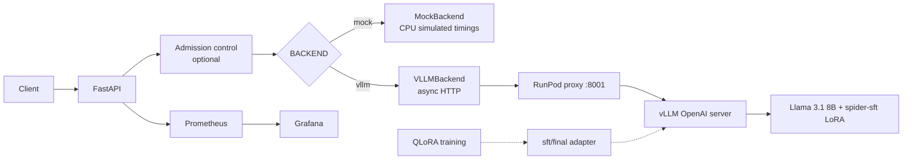

# LLM Inference Platform

Fine-tuning, serving, and observability for a Llama 3.1 8B text-to-SQL model.

This repository connects a QLoRA fine-tune of Llama 3.1 8B Instruct on Spider to a serving stack: FastAPI endpoints, a remote vLLM server with a LoRA adapter, Docker, RunPod GPU deployment, Prometheus and Grafana, concurrent load tests, and request-level logs. The goal is to measure and later improve inference throughput, tail latency, resource use, and cost — not to ship a chatbot.

Local development uses a CPU mock. Real weights run only on a rented GPU.

| Phase | Status |
| --- | --- |
| 1 | Complete — mock API, Docker, metrics, load tests |
| 2 | Complete — remote vLLM, LoRA, streaming, RunPod smoke |
| 3 | Validated on a RunPod L4 — caching, admission, metrics, tracing, and a short real benchmark. Not a Phase 4 study |
| 4 | Planned — GPU benchmarks and cost-per-request |

## Key results

Model quality (Spider 1.0, 1,034 examples). These numbers are not serving benchmarks.

| Metric | Base | Fine-tuned |
| --- | --- | --- |
| Exact-match accuracy | 40.5% | 73.3% |
| Execution accuracy | 49.9% | 75.7% |

Model: `meta-llama/Llama-3.1-8B-Instruct`. Method: QLoRA supervised fine-tuning (`r=16`, `lora_alpha=32`). Serving uses the `sft/final` adapter, exposed by vLLM as `spider-sft`.

On 15 October 2026 a RunPod NVIDIA L4 (Secure Cloud) running `vllm/vllm-openai:v0.8.5` served that adapter. FastAPI with `BACKEND=vllm` returned SQL with `"simulated": false`. Throughput and tail-latency numbers are not reported here; they belong to Phase 4. GPU session estimates are in [`ops/cost_tracker.md`](ops/cost_tracker.md).

## Features

**Inference**

- Llama 3.1 8B Instruct with a Spider SFT LoRA adapter
- vLLM OpenAI-compatible server (`/v1/chat/completions`, `/v1/models`)
- Adapter resolved to a local directory before vLLM starts
- SSE token streaming (`/generate/stream`)

**Infrastructure**

- FastAPI (`/healthz`, `/generate`, `/generate/stream`, `/metrics`)
- `MockBackend` (CPU, simulated timings) and `VLLMBackend` (async HTTP client)
- CPU image and Compose stack; GPU image and Compose stack for a rented NVIDIA host
- RunPod deployment scripts under [`ops/runpod/`](ops/runpod/README.md)

**Observability**

- Prometheus metrics labeled `backend` and `mode=simulated|real`
- Grafana dashboards for mock serving, real vs simulated serving, and Phase 3 admission / engine panels
- JSONL request logs
- Latency histograms, time to first token, and output tokens/sec
- Optional OpenTelemetry spans on the API path (`TRACING_ENABLED=false` by default)

**Benchmarking**

- Closed-loop concurrency and open-loop arrival rate
- Synthetic short, medium, long, repeated-schema, and unrelated-schema workloads
- Requests/sec, successful requests/sec, latency percentiles, rejections, and goodput
- Experiment plans for prefix caching, admission, and concurrency (executed in Phase 4)

## Architecture

Training writes the adapter. The serving process does not import the training package.



`VLLMBackend` only speaks HTTP. Weights stay on the GPU host, so the API can be developed and tested on CPU without a local GPU.

Prompts follow [`training/finetune_spider.py`](training/finetune_spider.py): a system instruction plus a user message with the schema, question, and `SQL:`. vLLM applies the model chat template.

## Quick start

Local stack. Responses are simulated (`"simulated": true`).

```bash
cp .env.example .env
docker compose up --build -d
```

| Service | URL |
| --- | --- |
| API docs | http://localhost:8000/docs |
| Health | http://localhost:8000/healthz |
| Prometheus | http://localhost:9090 |
| Grafana | http://localhost:3000 |

Grafana defaults are `admin` / `admin` unless `GF_SECURITY_ADMIN_USER` and `GF_SECURITY_ADMIN_PASSWORD` are set. Anonymous view is enabled in Compose.

```bash
curl http://localhost:8000/healthz

curl -X POST http://localhost:8000/generate \
  -H "Content-Type: application/json" \
  -d "{\"question\":\"List employees earning more than 50000.\",\"schema\":\"CREATE TABLE employees (id INTEGER, name TEXT, salary INTEGER);\",\"max_new_tokens\":32}"

curl -N -X POST http://localhost:8000/generate/stream \
  -H "Content-Type: application/json" \
  -d "{\"question\":\"List employee names.\",\"schema\":\"CREATE TABLE employees (id INTEGER, name TEXT);\",\"max_new_tokens\":32}"
```

SSE events: `meta`, `token`, `usage`, `done` (`error` on failure).

Without Docker:

```bash
pip install -r requirements.txt
uvicorn app.main:app --host 127.0.0.1 --port 8000
```

`BACKEND` defaults to `mock`.

## Real model serving

A RunPod pod runs vLLM. FastAPI stays a client.

| Setting | Value |
| --- | --- |
| Base model | `meta-llama/Llama-3.1-8B-Instruct` |
| Adapter | Hugging Face repo, subfolder `sft/final` |
| Served LoRA name | `spider-sft` |
| Context / memory | `MAX_MODEL_LEN=2048`, `GPU_MEMORY_UTILIZATION=0.85` |
| Client | `BACKEND=vllm`, `VLLM_BASE_URL` pointing at the pod proxy `/v1` |

The base model is gated and the adapter may be private. The pod needs `HF_TOKEN` with read access, and the same Hugging Face account must have accepted the Llama 3.1 license. [`ops/runpod/resolve_adapter.py`](ops/runpod/resolve_adapter.py) downloads the adapter to disk before vLLM starts. A raw repo id is not passed to `--lora-modules`.

Deployment, health checks, smoke tests, and shutdown: [`ops/runpod/README.md`](ops/runpod/README.md).

Point a local API at a running pod:

```bash
# .env
BACKEND=vllm
VLLM_BASE_URL=https://<pod-id>-8001.proxy.runpod.net/v1
VLLM_MODEL_NAME=spider-sft
```

```bash
uvicorn app.main:app --host 127.0.0.1 --port 8000
curl -s http://127.0.0.1:8000/healthz
```

A ready vLLM backend reports `"simulated": false`. Token counts come from the engine. Timings the engine does not return (for example queue wait on the non-streaming path) stay `null`.

## Observability

Prometheus scrapes FastAPI `/metrics` ([`ops/prometheus.yml`](ops/prometheus.yml)). Grafana loads:

- [Phase 1 — Simulated Mock Serving](ops/grafana/dashboards/phase1_mock_serving.json)
- [Phase 2 — Real vs Simulated Serving](ops/grafana/dashboards/phase2_real_serving.json)
- [Phase 3 — Admission, Cache, and Engine](ops/grafana/dashboards/phase3_serving.json)

| Series | Meaning |
| --- | --- |
| `llm_request_latency_seconds` | End-to-end latency histogram |
| `llm_inference_duration_seconds` | Mock prefill+decode, or remote HTTP time |
| `llm_ttft_seconds` | Time to first token on `/generate/stream` |
| `llm_queue_wait_seconds` | Mock worker queue only |
| `llm_simulated_output_tokens_per_second` | Last successful mock request |
| `llm_real_output_tokens_per_second` | Last successful vLLM request |
| `llm_remote_errors_total` | Remote / transport errors by category |
| `llm_admission_active` / `llm_admission_waiting` | API admission slots. Off when admission is disabled |
| `llm_admission_rejected_total` | API rejections (`full`, `wait_timeout`) |
| `llm_inflight_requests` | HTTP calls inside the backend client. Not a queue |
| `llm_queue_depth` | API waiters (mock lock, or admission queue when enabled). Not the vLLM scheduler |

`mode=simulated` is not GPU telemetry. Each request is also appended to `logs/requests.jsonl` (`REQUEST_LOG_PATH`). Prompt text is omitted unless `LOG_PROMPTS=true`.

On a GPU host, [`ops/prometheus.gpu.yml`](ops/prometheus.gpu.yml) scrapes FastAPI and vLLM on the Compose network. That Prometheus service does not publish a host port. vLLM v0.8.5 serves `/metrics` on the same port as the API (`8001`). A public proxy to `8001` can also reach `/metrics`. Copy `curl localhost:8001/metrics` off the pod before you terminate it. Empty `vllm:*` panels mean the series was not scraped. They are not zeros. Histogram quantiles on the dashboard are bucket estimates. Exact percentiles come from `bench/` request records.

## Phase 3 controls

Implemented in this tree. Not yet measured on a GPU, so there are no cache-hit, latency, or throughput claims here.

**Prefix caching.** `ENABLE_PREFIX_CACHING=true|false` becomes `--enable-prefix-caching` or `--no-enable-prefix-caching` on vLLM 0.8.5. The flag is always passed, because a V1 engine (the engine the L4 smoke started) enables caching when the flag is omitted. Changing it restarts vLLM. Caching reuses a matching token prefix. It is not an application answer cache.

**Admission.** `ADMISSION_ENABLED=false` by default, which forwards as in Phase 2. When enabled, `MAX_CONCURRENT_REQUESTS` (default 4) bounds active remote calls and `MAX_WAITING_REQUESTS` (default 8) bounds waiters. A full queue returns HTTP 503 with `Retry-After`. `MAX_QUEUE_WAIT_MS` (default 2000) bounds how long a waiter blocks. A streaming request holds its slot until the stream ends or the client disconnects. This is overload protection, not a per-client rate limit, and it does not replace vLLM’s scheduler.

**Tracing.** `TRACING_ENABLED=false` by default. When on, spans cover validation, admission wait, prompt assembly, the remote HTTP call or mock inference, and the stream. They do not record prompts, schemas, or tokens. They are not GPU prefill or decode times. Tracing adds overhead; leave it off for performance runs. Optional OTLP export needs `opentelemetry-exporter-otlp-proto-http`, which is not in the default requirements.

**Workloads.** `bench/workloads.py` builds synthetic SQL prompts (not Spider downloads): `short`, `medium`, `long`, `repeated-schema`, `unrelated-schema`. Plans for the Phase 4 comparisons are in `bench/experiments.py`.

## Benchmarking

[`bench/load_test.py`](bench/load_test.py) sends concurrent `POST /generate` requests and writes CSV plus a rollup JSON under `bench/results/`. [`bench/analyze.py`](bench/analyze.py) summarizes p50/p95/p99 and can plot them. The filename prefix is `simulated_` or `real_` from the API’s `simulated` field (`--label auto`).

CPU mock (default 20 requests per concurrency; raise `--requests` for tighter percentiles):

```bash
python -m bench.load_test --base-url http://127.0.0.1:8000 --concurrency 1,2,4,8 --requests 20 --analyze
python -m bench.load_test --pattern open --arrival-rate 2 --duration 5 --workload repeated-schema --requests 1
python -m bench.experiments --out bench/results/phase3_experiment_plan.json
```

`rps` in the summary is successful requests divided by wall time. `offered_rps` counts every attempt, including 503s and timeouts. Missing queue or inference timings stay null. `--latency-objective` adds `goodput_rps` for successes at or under that latency. p99 from fewer than 1,000 successes is marked unreliable.

Three different measurements:

| Run | What it measures |
| --- | --- |
| CPU load test | Client and API behavior with synthetic timings |
| Phase 2 smoke | A few real generations to prove the model and adapter load |
| Phase 4 GPU benchmark | Throughput, tail latency, and cost on a rented GPU |

Phase 4 will record output tokens/sec, requests/sec, time to first token, p50/p95/p99, concurrency, queue wait where the backend provides it, GPU memory and cache use, and cost per successful request. Those figures are not in this repository yet.

## Repository layout

```
training/                 QLoRA script and training requirements
app/
  main.py                 HTTP API
  serving.py              Request path shared by both backends
  backends/mock.py        CPU mock
  backends/vllm.py        Remote vLLM client
  admission.py            Optional API backpressure
  metrics.py              Prometheus series
  tracing.py              Optional OpenTelemetry spans
bench/                    Load test, workloads, experiment plans
ops/
  prometheus.yml
  grafana/                Dashboards and provisioning
  runpod/                 GPU setup, smoke, cleanup
  cost_tracker.md         GPU session and cost record
tests/                    CPU tests; vLLM is mocked over HTTP
Dockerfile                CPU API
Dockerfile.gpu            vllm/vllm-openai:v0.8.5 + LoRA entrypoint
docker-compose.yml        Local mock + Prometheus + Grafana
docker-compose.gpu.yml    GPU host: vLLM and optional API
```

## Roadmap

**Phase 1 — complete.** FastAPI, CPU mock, Docker Compose, Prometheus, Grafana, JSONL logs, concurrent load tests.

**Phase 2 — complete.** Remote vLLM client, retries, LoRA serving, SSE streaming, real vs simulated metrics, RunPod scripts, L4 smoke test.

**Phase 3 — validated on one L4 session.** Prefix caching on and off, admission (including a 503), vLLM `/metrics`, Prometheus scrapes of the API and vLLM, API traces, and short closed-loop and open-loop benches all ran against `spider-sft`. Samples are small. They are not the Phase 4 result. Raw files are in `bench/results/phase3_validation/` and are not committed.

**Phase 4 — planned.** GPU benchmark comparison: tokens/sec, p95/p99, utilization, and cost per successful request from the final benchmark run.

## Tests and limits

```bash
pip install -r requirements.txt
pytest -q
```

Tests do not load Llama or CUDA. They do not prove a GPU smoke.

Limits:

- Mock timings are a fixed prefill plus per-token model. They are not a GPU.
- Phase 2 smoke checked correctness of the path (model listed, SQL returned, `simulated: false`). It is not a capacity study.
- `llm_queue_wait_seconds` is the mock lock. Engine queue time is `vllm:request_queue_time_seconds` when that series is scraped.
- GPU KV-cache hit rate and invoice-backed cost-per-request are not measured yet. Phase 3 only prepares the measurement path.
- Real serving needs a GPU pod, a Hugging Face token, and access to the gated base model and adapter.

Training: [`training/finetune_spider.py`](training/finetune_spider.py), [`training/requirements-training.txt`](training/requirements-training.txt).

GPU spend: [`ops/cost_tracker.md`](ops/cost_tracker.md).
