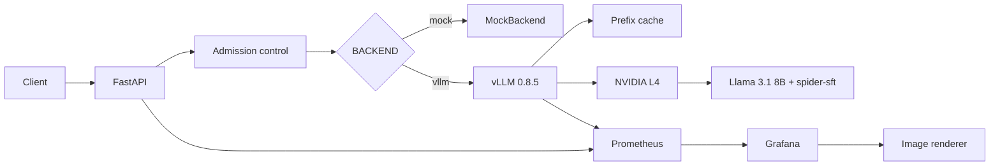
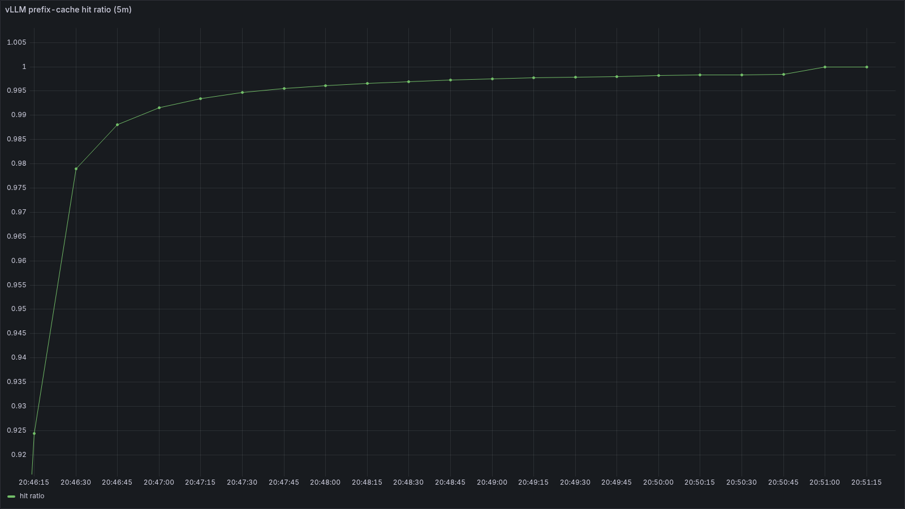
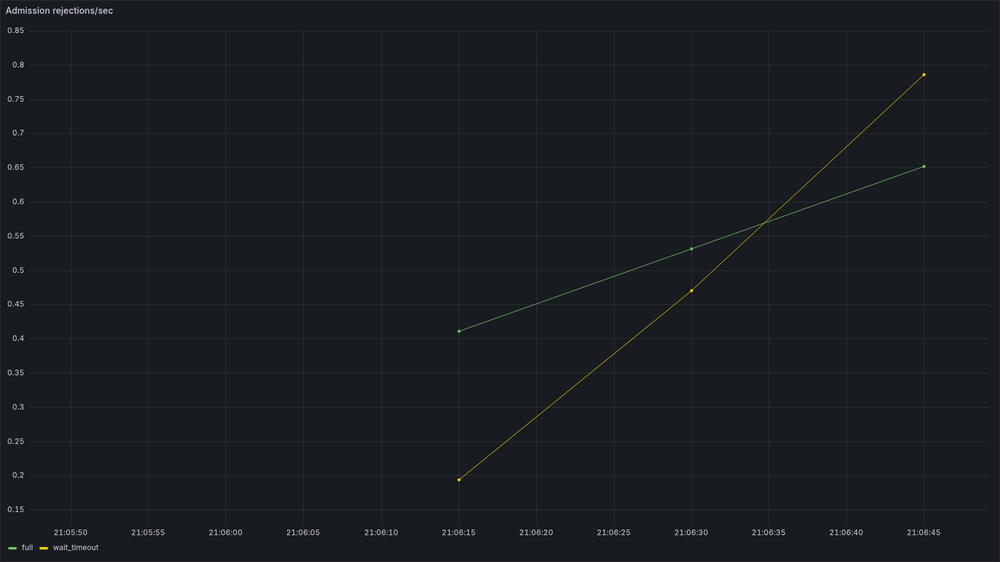
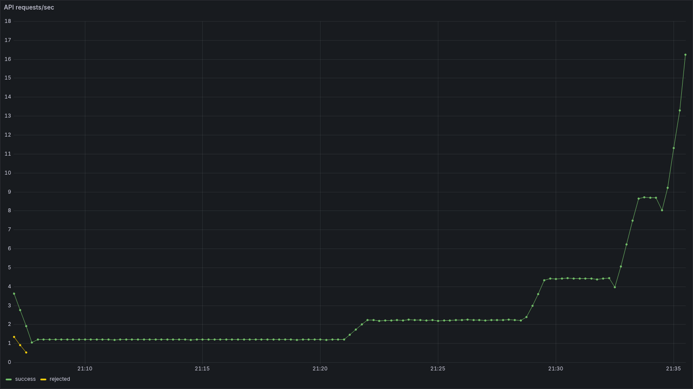
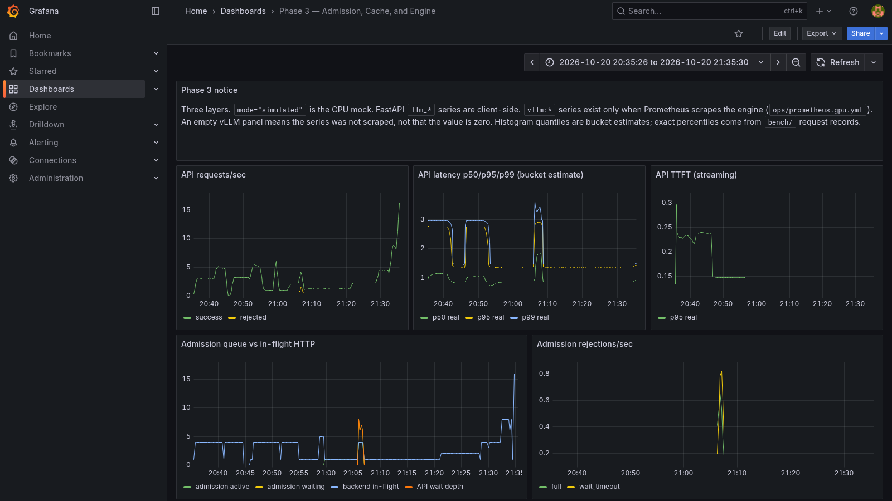

# LLM Inference Platform

End-to-end fine-tuning, serving, observability, and inference-performance measurement for a QLoRA-tuned Llama 3.1 8B Instruct model on Spider text-to-SQL.

The serving path is FastAPI in front of vLLM. A RunPod NVIDIA L4 loads the base model and the `spider-sft` LoRA adapter. The API adds optional admission control, SSE streaming, Prometheus metrics, and optional OpenTelemetry spans. Prefix caching is a vLLM engine feature, not an application response cache. Local development uses a CPU mock. Real weights run only on a rented GPU.

## Key results

Model quality and serving performance are different measurements.

**Model quality.** Spider 1.0, 1,034 evaluation examples. QLoRA (`r=16`, `lora_alpha=32`) on `meta-llama/Llama-3.1-8B-Instruct`. The served adapter is `sft/final`, exposed as `spider-sft`.

| Metric | Base | Fine-tuned |
| --- | --- | --- |
| Exact-match accuracy | 40.5% | 73.3% |
| Execution accuracy | 49.9% | 75.7% |

**Serving, one condition.** Closed-loop concurrency 16, synthetic `short` prompts, `max_new_tokens=64`, temperature 0, admission off, 1,000 successes, 0 failures. NVIDIA L4, vLLM 0.8.5. These figures are aggregate throughput, not per-request generation speed.

| Metric | Value |
| --- | --- |
| Aggregate output tokens/sec | 201.8 |
| Successful requests/sec | 16.0 |
| p50 / p95 / p99 latency | 1.01 s / 1.46 s / 1.47 s |

Prefix-cache and admission results are in [Phase 4 benchmark results](#phase-4-benchmark-results). They are not folded into the row above. Counts and percentiles were recomputed from the request CSVs. The public rollup is [`docs/phase4_summary.json`](docs/phase4_summary.json). Raw CSVs stay local.

Estimated GPU spend is in [`ops/cost_tracker.md`](ops/cost_tracker.md). The Phase 4 rental estimate is **$0.80**. The measured-request windows alone are **$0.56**, or about **$0.000054 per successful request** and **$4.08 per million output tokens**. Those are `duration × $0.59/h`, not an invoice.

## Architecture



On the Phase 4 pod, vLLM, FastAPI, and Prometheus were processes inside `vllm/vllm-openai:v0.8.5`. That image has no Docker daemon, so Compose was not how the benchmark ran. [`docker-compose.gpu.yml`](docker-compose.gpu.yml) remains the stack for a host that does have Docker and an NVIDIA GPU.

The mock backend never loads weights. `VLLMBackend` is an HTTP client. Prompts match [`training/finetune_spider.py`](training/finetune_spider.py): a system instruction and a user message with schema, question, and `SQL:`. vLLM applies the chat template.

## What the system does

**Inference.** QLoRA adapter served by vLLM’s OpenAI-compatible API. FastAPI is async. `/generate/stream` emits SSE. Client TTFT is the first nonempty `token` event, not the `meta` event.

**Reliability.** Admission is off by default. When on, it bounds active calls (`MAX_CONCURRENT_REQUESTS`, default 4) and waiters (`MAX_WAITING_REQUESTS`, default 8). A full queue or a wait past `MAX_QUEUE_WAIT_MS` (default 2000) returns HTTP 503 with `Retry-After`. A stream holds its slot until the body finishes or the client disconnects. This is overload protection, not a per-user rate limit, and it is not the vLLM scheduler queue.

**Prefix caching.** `ENABLE_PREFIX_CACHING` becomes `--enable-prefix-caching` or `--no-enable-prefix-caching`. vLLM 0.8.5 V1 enables caching if the flag is omitted, so the entrypoint always passes one. Switching it restarts vLLM. The cache reuses a matching token prefix.

**Observability.** Prometheus scrapes the API and, on a GPU host, vLLM `/metrics`. Grafana dashboards distinguish mock timings from engine series. Optional OpenTelemetry spans cover validation, admission, prompt assembly, and the remote call. They do not record prompts, and they are not GPU prefill or decode traces. Leave tracing off for performance runs.

**Benchmarking.** Closed-loop concurrency and open-loop arrivals. Summaries report p50/p95/p99, streaming TTFT, successful and offered requests/sec, aggregate output tokens/sec, and rejections. Missing timings stay null. p99 from fewer than 1,000 successes is marked unreliable.

## Phase 4 benchmark results

One trial per condition, seed 42, temperature 0, `max_new_tokens=64`. Every recorded success has `simulated: false`. Hardware: NVIDIA L4 24 GB, Secure Cloud, EU-RO-1, `vllm/vllm-openai:v0.8.5`.

### Prefix caching

Closed loop, concurrency 4, streaming, 1,000 successes, 0 failures. vLLM was restarted when the flag changed. Warmup was 20 requests and is excluded from the window.

| Workload | Cache | Mean TTFT | p50 latency | p99 latency | Output tok/s |
| --- | --- | --- | --- | --- | --- |
| Repeated schema | off | 151 ms | 1.05 s | 2.60 s | 54.0 |
| Repeated schema | on | 135 ms | 1.00 s | 2.48 s | 56.4 |
| Unrelated schemas | off | 154 ms | 0.84 s | 1.20 s | 51.0 |
| Unrelated schemas | on | 134 ms | 0.80 s | 1.13 s | 54.4 |

Mean TTFT fell about 10% on the repeated-schema pair and about 12% on the unrelated-schema control. Aggregate tokens/sec rose about 4% and 7%. The control moved as much as the shared-prefix pair, so this run does not isolate a prefix-cache speedup. The engine hit-ratio panel for the repeated, cache-on window is high after the first minute. Hit and query counters were not written into the result archive, so the README does not quote a hit rate.



Repeated-schema prompts, caching on, 20:46:13Z–20:51:25Z. The panel is the engine hit ratio, not a latency result.

### Admission control

Open loop, synthetic `short` prompts, non-streaming. Defaults: 4 active, 8 waiting, 2,000 ms wait. Below-capacity rows have 180 completions, so their p99 is a weak tail estimate.

| Offered rate | Admission | Completed | HTTP 503 | Accepted p50 | Accepted p99 |
| --- | --- | --- | --- | --- | --- |
| 1 req/s for 180 s | off | 180 | 0 | 0.85 s | 1.25 s |
| 1 req/s for 180 s | on | 180 | 0 | 0.86 s | 1.25 s |
| 6 req/s for 60 s | off | 360 | 0 | 0.91 s | 1.36 s |
| 6 req/s for 60 s | on | 268 | 92 | 2.02 s | 3.01 s |

At 1 req/s the limiter did nothing. At 6 req/s the GPU, with admission off, completed every request at about the same latency as the 1 req/s run. Turning the limiter on rejected 92 of 360 requests (26%) and made the accepted requests slower, not faster. That is the cost of a cap set below what this L4 was already serving. A 2 req/s, admission-on run (360 completions, 0 rejections, p50 0.89 s) had no matched admission-off run of the same length. No latency objective was configured, so goodput was not recorded.



Admission on, 21:05:47Z–21:06:49Z. `full` and `wait_timeout` are the API 503 reasons. They are not vLLM preemptions.

### Concurrency

Closed loop, `short` prompts, non-streaming, admission off, 1,000 successes and 0 failures at each level. Prefix caching stayed on from the previous condition. Concurrency 32 was not run.

| Concurrency | Requests/s | Output tok/s | p50 | p95 | p99 |
| --- | --- | --- | --- | --- | --- |
| 1 | 1.20 | 15.2 | 0.86 s | 1.24 s | 1.25 s |
| 2 | 2.23 | 28.1 | 0.89 s | 1.35 s | 1.35 s |
| 4 | 4.42 | 55.6 | 0.93 s | 1.33 s | 1.33 s |
| 8 | 8.65 | 108.9 | 0.95 s | 1.36 s | 1.36 s |
| 16 | 16.0 | 201.8 | 1.01 s | 1.46 s | 1.47 s |

Throughput scaled with concurrency through 16. p99 rose from 1.25 s to 1.47 s. Nothing in the sweep shows a plateau, so 16 is the best tested point, not a proven optimum. At concurrency 1, 15.2 tok/s is the single-request rate. At concurrency 16, 201.8 tok/s is the aggregate.



Sequential closed-loop levels from 21:06:58Z to 21:35:31Z. The steps match the table. The short rejection mark at the left is the tail of the preceding admission run, not a concurrency failure. Each concurrency summary has zero HTTP 503s.

### Cost

Quoted rate $0.59/h. Sum of measured condition wall clocks: 0.945 h, about **$0.56**. That window contains 10,388 successful requests and 136,554 output tokens.

| Quantity | Estimate |
| --- | --- |
| Per successful request | $0.000054 |
| Per million output tokens | $4.08 |
| Full pod session, including load and Grafana | $0.80 |

The session figure is not the efficiency figure. Neither number is an invoice.



20:35:27Z–21:35:31Z, every completed condition. Panels change when the workload changes. Histogram quantiles on the dashboard are bucket estimates. The tables above are the request-record percentiles.

Other exports, same directory: [cache off](docs/images/phase4/prefix-cache-off.png), [cache on](docs/images/phase4/prefix-cache-on.png), [admission overload](docs/images/phase4/admission-overload.png), [concurrency latency](docs/images/phase4/concurrency-latency.png), [KV cache](docs/images/phase4/gpu-kv-cache.png). Windows are in [`docs/images/phase4/manifest.json`](docs/images/phase4/manifest.json). A numeric KV-cache peak was not saved in the result archive.

## Quick start

CPU mock. Responses are simulated.

```bash
python -m pip install -r requirements.txt
uvicorn app.main:app --host 127.0.0.1 --port 8000
pytest -q
```

`BACKEND` defaults to `mock`. Do not start [`docker-compose.gpu.yml`](docker-compose.gpu.yml) on a machine without an NVIDIA GPU.

Optional local monitoring stack:

```bash
docker compose up --build -d
```

| Service | URL |
| --- | --- |
| API docs | http://localhost:8000/docs |
| Health | http://localhost:8000/healthz |
| Prometheus | http://localhost:9090 |
| Grafana | http://localhost:3000 |

Grafana in Compose is `admin` / `admin` unless overridden. Anonymous view is enabled there only.

Benchmark plans and a dry run do not open a socket and do not start a GPU:

```bash
python -m bench.experiments --out bench/results/phase3_experiment_plan.json
python -m bench.run_phase4 --mode dry-run --experiment-id A-repeated-off --workload repeated-schema --concurrency 4 --stream
```

A smoke against an already running API:

```bash
python -m bench.run_phase4 --mode smoke --base-url http://127.0.0.1:8000 --experiment-id smoke --workload short --concurrency 1 --requests 4
```

GPU setup, the Phase 4 campaign, and Grafana export: [`ops/runpod/README.md`](ops/runpod/README.md).

## Limits

- The L4 numbers are one machine, one trial per condition, synthetic SQL prompts, and `max_new_tokens=64`. They are not a Spider accuracy result.
- The unrelated-schema control moved with the cache flag, so the TTFT drop is not attributed to prefix caching.
- Admission p99 values are from 180 or 360 requests. The 1,000-request runs are the ones marked as empirical percentiles.
- Admission can reject traffic without making accepted requests faster. That is what happened at 6 req/s.
- API traces are not per-request GPU traces.
- This is not a multi-tenant serving system. Grafana on the pod was bound to localhost and reached through SSH. That URL dies when the pod is terminated.

## Layout

```
training/                 QLoRA script
app/                      FastAPI, admission, metrics, vLLM client
bench/                    Load test, Phase 4 runner, Grafana export
docs/images/phase4/       Grafana PNGs from the L4 run
docs/phase4_summary.json  Figures used in this README
ops/runpod/               Pod runbook
ops/cost_tracker.md       GPU session estimates
tests/                    CPU tests; vLLM is mocked over HTTP
```

Training: [`training/finetune_spider.py`](training/finetune_spider.py). GPU spend: [`ops/cost_tracker.md`](ops/cost_tracker.md).
